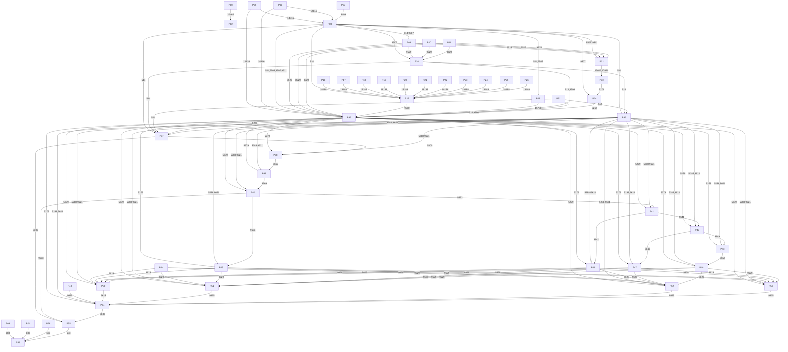

# Resource dependency graph (producer -> consumer)

Generated from RTV/DSV/UAV writes and SRV/copy reads per pass.

## Texture producer/consumer table (key RTs)

| texture | format | written by | read by (pass:slots) |
|---|---|---|---|
| tex9503 | R8G8B8A8_TYPELESS 3072x1920 | P8(RTV) | P35(ps0,ps1,ps2,ps4,ps6,ps8) |
| tex9507 | R16G16B16A16_TYPELESS 3072x1920 | P8(RTV) | P9(ps0), P29(ps0), P30(ps3), P32(ps0), P34(ps0), P35(ps1,ps2,ps3) |
| tex9511 | R8_TYPELESS 3072x1920 | P8(RTV) | P32(ps1), P35(ps2,ps3,ps5) |
| tex9515 | R32G8X24_TYPELESS 3072x1920 | P8(DSV), P27(DSV), P29(DSV), P35(DSV), P36(DSV) | P8(copy) |
| tex9580 | R8_TYPELESS 3072x1920 | P27(RTV) | P35(ps 9571 Ref192 / ps 9572 Ref128) |
| tex9596 | R8G8B8A8_TYPELESS 3072x1920 | P30(RTV), P31(RTV) | P35(ps7,ps8) |
| tex15780 | R11G11B10_FLOAT 3072x1920 | P29(RTV) | P35(ps9) |
| tex5279 | R11G11B10_FLOAT 3072x1920 | P35(RTV) | P37(ps1), P38(ps1), P39(ps1), P40(ps1), P41(ps1), P42(ps1), P43(ps1), P45(ps1), P46(ps1), P47(ps1), P48(ps1), P50(ps1), P51(ps1), P52(ps1), P53(ps1), P54(ps1) |
| tex9621 | R16G16_TYPELESS 3072x1920 | P36(RTV) | P37(ps3), P38(ps3), P39(ps3), P40(ps3), P41(ps3), P42(ps3), P43(ps3), P45(ps3), P46(ps3), P47(ps3), P48(ps3), P50(ps3), P51(ps3), P52(ps3), P53(ps3), P54(ps3) |
| tex5288 | R8_TYPELESS 3072x1920 | P36(RTV) | P37(ps4), P38(ps4), P39(ps4), P40(ps4), P41(ps4), P42(ps4), P43(ps4), P45(ps4), P46(ps4), P47(ps4), P48(ps4), P50(ps4), P51(ps4), P52(ps4), P53(ps4), P54(ps4) |
| tex683 | R8G8B8A8_TYPELESS 2560x1600 | P3(RTV), P4(RTV), P28(RTV), P55(RTV) | P56(ps0) |
| tex14816 | R16_TYPELESS 3072x3072 | P5(DSV), P6(DSV) | P8(ps6,ps8), P35(ps4,ps6) |
| tex18188 | R16_TYPELESS 1536x2560 | P16(DSV), P17(DSV), P18(DSV), P19(DSV), P20(DSV), P21(DSV), P22(DSV), P23(DSV), P24(DSV), P25(DSV), P26(DSV) | P27(ps1) |
| tex17638 | R16_TYPELESS 12288x4096 | - | P27(ps1) |
| tex9529 | R32_TYPELESS 1536x960 | P9(RTV), P10(RTV), P11(RTV) | P30(ps0), P35(ps0) |
| tex3403 | R8G8B8A8_TYPELESS 1536x960 | - | P30(ps4), P35(ps4,ps6,ps7) |
| tex5267 | R16G16B16A16_TYPELESS 1728x1080 | P34(RTV) | P33(ps2), P35(ps6) |
| tex514 | R32G8X24_TYPELESS 3072x1920 | P8(CopyDst), P30(DSV), P31(DSV) | P9(ps0), P27(ps0), P29(ps1), P35(ps0,ps10,ps3,ps4,ps5,ps6,ps8), P36(ps0), P37(ps0) |
| tex9499 | R16_TYPELESS 1536x960 | P7(DSV) | P8(ps5) |

All textures and their usage are in `raw/pass_detail.json` (per pass) and `raw/xml_resources.json`.